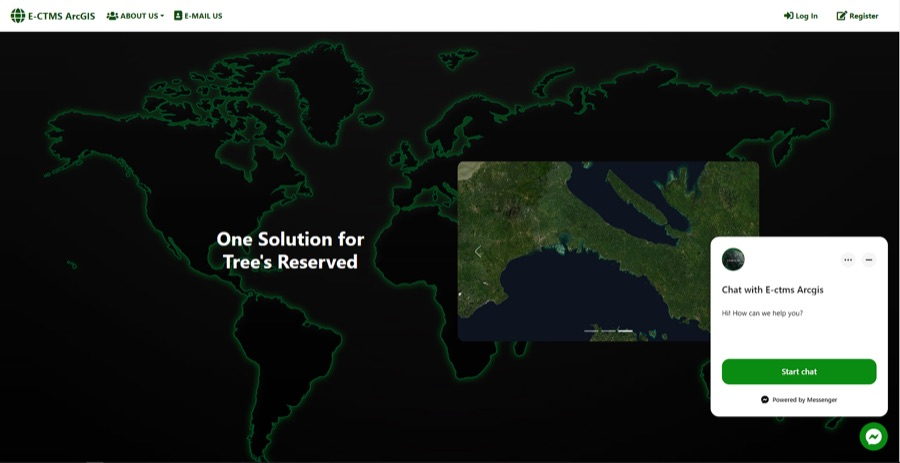
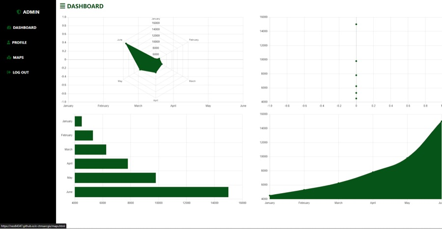
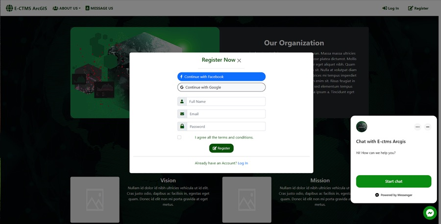
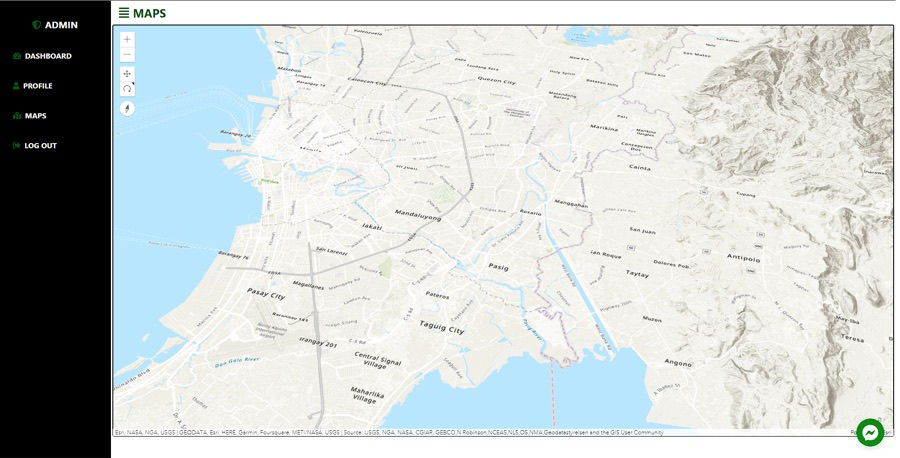

# E-CTMS ArcGIS

> **Mini Project 1** from the KodeGo Full-Stack Web Development Bootcamp (2022). For educational purposes only.

A multi-page front-end web app for a tree-reserve organisation. It has a sign-in landing page, a dashboard with charts, an interactive **3D ArcGIS map**, and a **Facebook Messenger** chat plugin for contacting the organisation.

**Live demo:** https://neo64347.github.io/e-ctmsarcgis/

| | |
|---|---|
|  |  |
|  |  |

## Features
- **3D map:** ArcGIS Maps SDK for JavaScript 4.24 `SceneView` with a topographic basemap and world elevation (`maps.html`, `assets/js/iarcgis.js`)
- **Dashboard:** charts built with Chart.js (`dashboard.html`)
- **Pages:** profile, team, organisation and contact (`profile.html`, `team.html`, `organization.html`, `messageus.html`)
- **Messenger chat:** customer chat plugin (`assets/js/messenger.js`)
- Responsive layout with Bootstrap 5 and AOS scroll animations

## Tech stack
HTML · CSS · Bootstrap 5 · JavaScript · ArcGIS Maps SDK for JS · Chart.js · Messenger Platform · GitHub Pages

## Run locally
It's a static site with no build step:
```bash
git clone https://github.com/neo64347/e-ctmsarcgis.git
cd e-ctmsarcgis
python3 -m http.server 8000   # then open http://localhost:8000
```
The 3D map needs an ArcGIS API key that allows your origin. See `esriConfig.apiKey` in `assets/js/iarcgis.js`.

## Author
**John Ed Manauis**: [Portfolio](https://neo64347.github.io/portfolio-manauis/) · [LinkedIn](https://www.linkedin.com/in/johnedmanauis/)
